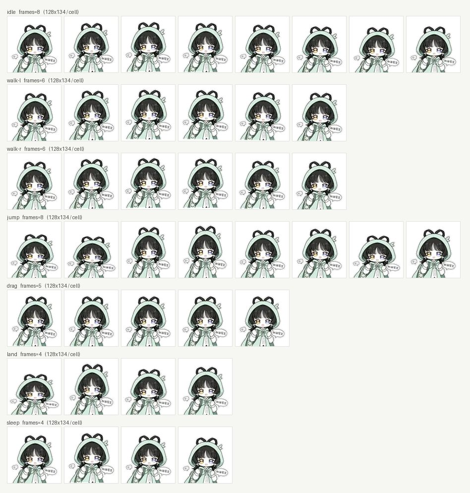

# 桌宠动作系统（帧动画）说明

> 面向要改这块代码的人。看完应该能回答三个问题：动画是怎么播的、状态是怎么切的、素材从哪来 / 怎么换。

## 1. 改造前后

| | 改造前 | 改造后 |
|---|---|---|
| 身体 | 三张静态 WebP，`` 直接切 `src` | `<canvas>` 逐帧播放 sprite sheet（也支持 GIF） |
| 待机 | 整块 `translateY` 漂浮 + 三段随机 CSS 小动作 | 8 帧呼吸 / 挤压，深夜换成 4 帧慢呼吸 |
| 走动 | 无 | 自主横向移动，左右两套倾斜帧，位置写回存档 |
| 跳跃 | 无（只有 CSS `is-hop` 原地弹一下） | 8 帧蓄力 / 拉伸 / 落地 + 真实离地位移 |
| 拖拽 | 只改 CSS `rotate(-5deg)` | 5 帧「被拎住兜帽」的钟摆姿态；松手播 4 帧落地缓冲 |
| 状态 | 没有状态概念 | 显式状态机：`drag > land > jump > walk > idle` |

静态图片没有被删除：小圆点（收起态）仍然用原图裁成头像，`face.img` 还负责首屏预解码。

## 2. 目录与职责

```
src/mascot/
├── animations.js         帧条清单（帧数 / 帧率 / 是否循环）、状态→素材解析、空闲预热
├── useMascotMotion.js    动作状态机：自主动作排程、走动位移、跳跃抛物线、拖拽接管
├── config.js             动作参数（速度 / 距离 / 间隔 / 跳跃高度）与设置项
├── useMascotTimers.js    统一的 timer / rAF 登记表（本次修好了 rAF 不传时间戳的问题）
└── ..

src/components/
├── MascotSprite.vue      帧播放器：canvas 绘制、sprite sheet / GIF 双格式、播完 emit('ended')
├── Mascot.vue            组装层：手势、菜单、台词、路由联动（只加了接线，没改原有逻辑）
└── MascotOverlays.vue    菜单里新增「跳一下」和两个设置开关

src/assets/mascot/anim/   21 张帧条（3 个表情 × 7 个动作）
scripts/gen_mascot_frames.py  帧条生成脚本（可复现）
```

## 3. 状态机

| 状态 | 素材 | 帧率 | 进入条件 | 离开 |
|---|---|---|---|---|
| `idle` | `<face>-idle`（深夜用 `sleep`） | 5 fps / 2.5 fps | 默认；跳跃、走动、落地结束 | 定时排程自主动作 |
| `walk` | `<face>-walk-l` / `walk-r` | 9 fps | 空闲 11–26s 后按 62% 概率 | 到达目标点 → 22% 概率接跳跃，否则 idle |
| `jump` | `<face>-jump` | 12 fps | 自主动作 22%、点击轻跳、菜单「跳一下」 | 0.67s 后落地 → idle |
| `drag` | `<face>-drag` | 8 fps | 指针移动超过 6px，被拖拽接管 | 松手 → `land` |
| `land` | `<face>-land` | 16 fps | 拖拽松手 | 0.25s 后 → idle |

几条约束：

* **拖拽优先级最高**：`beginDrag()` 会立刻清掉走动 / 跳跃的 rAF 与排程，用户的手永远优先。
* **悬停 / 菜单只挂起、不强杀**：`hold()` 会让走动就地停下，但正在播的跳跃会自然落地，避免半空冻结。
* **所有定时器走 `useMascotTimers`**：收起、切后台、组件卸载时统一清空，不会留下后台 rAF。
* **姿态与位移分离**：帧只负责挤压 / 拉伸 / 呼吸；左右倾斜来自 `--mc-lean`，跳跃高度来自 `--mc-lift`，由 CSS `transform` 消费。改跳跃高度不用重烘焙素材。



> 上图是 welcome 表情的 7 套帧条（idle / walk-l / walk-r / jump / drag / land / sleep），
> 每格就是一帧；走动时的大幅倾斜由运行时 CSS 叠加，所以帧条里看着只差上下起伏。


参数都在 `src/mascot/config.js` 的「动作系统」一节：

```js
WALK_SPEED = 34      // px/s
WALK_MIN_PX / MAX_PX // 单次走动距离
ROAM_MIN_MS / MAX_MS // 两次自主动作的间隔
JUMP_PX = 18         // 跳跃高度
WALK_LEAN = 3.2      // 走动倾斜角度
```

## 4. 素材管线

`scripts/gen_mascot_frames.py` 用 Pillow 把三张静态立绘烘焙成帧条（不是运行时算的，是真实图片）：

```bash
pip install Pillow
python scripts/gen_mascot_frames.py
```

约定（播放器和脚本必须一致）：

* 单元格固定 **128 × 134**，横向条带，第 i 帧 = `(i*128, 0, (i+1)*128, 134)`；
* 人物底边永远贴单元格底边，切换状态时脚不跳；
* 所有帧共用同一画布，不做自动裁剪，避免不同状态下人物忽大忽小；
* 帧数写在 `animations.js` 的 `CLIPS` 里，改帧数要两边一起改。

体积（实测）：

| 项目 | 数值 |
|---|---|
| 21 张帧条合计 | 684 KB |
| 单个表情的 idle 帧条 | 43–48 KB |
| 首屏实际加载 | 只有当前表情的 idle（≈45 KB），其余由 `preloadMotion()` 在 `requestIdleCallback` 里串行预热 |

体积主要花在 alpha 通道和头发细节上，降 quality 收益很小（q82 → q66 只省约 20%），所以选了 128px + q76 的平衡点。

### 换成手绘帧 / Shimeji 素材

保持「横向条带 + 128×134 + 底边对齐 + 帧数一致」，覆盖同名文件即可，代码零改动。
如果美术给的是单张 PNG 序列，用脚本里 `render()` 的思路拼成条带，或者直接改 `CLIPS` 指向新的 sheet。

### 用 GIF

`animations.js` 里留了覆盖入口：

```js
import idleGif from '../assets/mascot/anim/gif/welcome-idle.gif'
CUSTOM_SHEETS['welcome-idle'] = idleGif
```

播放器检测到 `.gif` 会自动走 GIF 解码分支，帧数 / 帧率以 GIF 自身为准。
代价：GIF 只有 1bit 透明，边缘会有锯齿，所以默认仍是 WebP 帧条。

## 5. 引入的开源项目与用法

| 项目 | 许可证 | 用法 |
|---|---|---|
| [gifuct-js](https://github.com/matt-way/gifuct-js) | MIT | 把 GIF 解成帧（`parseGIF` + `decompressFrames`），合成与计时由 `MascotSprite.vue` 接管 |
| [吱吱吉 Shimeji](https://github.com/YuZhu412/zhizhiji-shimeji) | 仅参考思路，未引入代码 | 「一张静态图生成 idle / walk / drag / fall 帧序列」的管线：统一画布、底部锚点、垂直位移模拟重心 |
| Shimeji-ee 的动作命名 | 仅参考设计 | `idle / walk / drag / fall` 这套状态划分是桌宠类应用的通用约定，本项目的状态机按它对齐，方便以后直接吃 Shimeji 素材包 |

### gifuct-js 具体怎么接的

依赖是**按需加载**的：只有真的用到 `.gif` 素材时才会 `import('gifuct-js')`，默认的帧条路径不会把它打进首屏。

```js
// MascotSprite.vue
const mod = await import('gifuct-js')
const api = mod.default && mod.default.parseGIF ? mod.default : mod
const parsed = api.parseGIF(arrayBuffer)
const raw = api.decompressFrames(parsed, true) // true = 顺便生成 canvas 可直接用的 patch

// GIF 的 disposal 语义要自己处理：2 = 清掉上一帧区域，3 = 还原到上一帧之前
if (pendingDisposal === 2) gctx.clearRect(...)
else if (pendingDisposal === 3) gctx.putImageData(prevSnapshot, 0, 0)
gctx.putImageData(frame.patch, frame.dims.left, frame.dims.top)
```

注意 v2 是**函数式 API**（`parseGIF` / `decompressFrames`），网上不少教程还是旧版的 `new GIF(buffer)`，直接照抄会报 `GIF is not a constructor`。

安装：`npm install gifuct-js`（已写进 `package.json`）。

## 6. 与原有能力的兼容

以下行为保持不变，改这块时别破坏：

* 拖拽跟手、松手靠边吸附、坐标 / 尺寸 / 透明度 / 静音 / 表情包存档与 v2→v3 迁移；
* 单击说话、双击收起、长按 / 右键 / ⋯ 开菜单、Esc 关闭、方向键走焦点；
* 静音 / 收起 / 后台时不说台词，轮询跟着 timer registry 一起停；
* 深夜压暗 + Zzz、路由场景表情、编辑器保存提醒、未读消息播报；
* 浮层在顶部自动翻到下方；小屏（<700px）自动收起；
* 省电模式：帧动画冻结在第一帧（不再是简单粗暴地 `animation: none`）。

新增的两个设置项 `motion`（动态动作）和 `roam`（自由走动）在 `DEFAULT_SETTINGS` 里有默认值，旧存档读出来会自动补齐，不需要迁移版本号。

## 7. 已验证

* `npm run build` 通过；帧条作为独立资源产出，GIF 解码器被拆成单独 chunk（≈7 KB）。
* 无头浏览器实测：idle 帧在推进；点击后 `state-jump` 持续约 0.67s、最大离地 7.9px（轻跳档 8px）；
  `startWalk()` 后横移 74px、`state-walk` 保持、倾斜角生效；拖拽进入 `state-drag`、松手回 idle；
  关掉动态动作 / 开省电后画面冻结且 `clip` 变成 `*-static`，恢复后继续。
* 自主行为也做过端到端验证（临时忽略无头浏览器的 `prefers-reduced-motion: reduce`）：
  一次完整序列是 `idle → 24s 自主走动（横移 182px）→ 走到后顺势跳跃 → 回到 idle`，
  说明排程、走动、落地、再次排程这条链是通的。
* 用临时 GIF 验证过解码分支：`src` 指向 `.gif` 后画面正常逐帧推进，控制台无报错。
